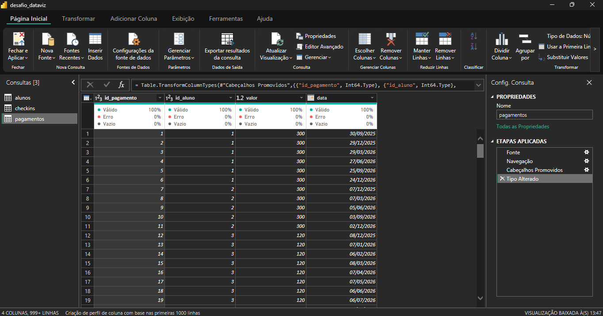

# ETL — Extração, transformação e carga

## 1. Carregamento e tratamento dos dados

Inicialmente, foram carregadas três tabelas a partir do arquivo Excel: `alunos`, `checkins` e `pagamentos`.

Durante a inspeção inicial, não foram identificados valores nulos, registros duplicados ou inconsistências na representação dos valores decimais.

A única alteração necessária foi na coluna `valor`, da tabela `pagamentos`, cujo tipo de dado original era inteiro. O tipo foi alterado para decimal, adequando sua representação à natureza monetária dos dados. Apesar da conversão, os valores permaneceram iguais, pois todos os pagamentos da base foram registrados em valores inteiros.



## 2. Criação da dimensão calendário

As instruções do desafio exigem a utilização de filtros temporais para analisar os indicadores do dashboard. Para atender a esse requisito, foi criada uma dimensão calendário compartilhada pelas tabelas `fCheckins` e `fPagamentos`.

### 2.1. Definição do intervalo de datas

Para determinar a abrangência da dimensão calendário, foram consideradas as datas mais antigas e mais recentes presentes nas duas tabelas fato.

Dessa forma, o calendário contempla todo o intervalo de datas disponível, permitindo que ambas as tabelas utilizem a mesma dimensão temporal.

A implementação foi realizada em duas etapas. Primeiramente, foi criada a tabela calendário, utilizando a função `CALENDAR` para gerar uma sequência contínua de datas entre os limites definidos.

```dax
dCalendario =
VAR dataMin =
    IF(
        MIN(fCheckins[data]) < MIN(fPagamentos[data]),
        MIN(fCheckins[data]),
        MIN(fPagamentos[data])
    )
VAR dataMax =
    IF(
        MAX(fCheckins[data]) > MAX(fPagamentos[data]),
        MAX(fCheckins[data]),
        MAX(fPagamentos[data])
    )
RETURN
    ADDCOLUMNS(
        CALENDAR(dataMin, dataMax),
        "ano", YEAR([Date]),
        "mes num", MONTH([Date]),
        "mes abrev", FORMAT([Date], "MMM"),
        "dia", DAY([Date]),
        "dia da semana", FORMAT([Date], "ddd")
    )
```

A variável `dataMin` compara as menores datas das duas tabelas e retorna a mais antiga. De maneira semelhante, `dataMax` compara as maiores datas e retorna a mais recente.

Com esses limites definidos, a função `CALENDAR` gera todas as datas do intervalo, enquanto `ADDCOLUMNS` acrescenta atributos temporais que serão utilizados nas análises.

### 2.2. Ordenação dos dias da semana

Durante a elaboração da dimensão, foi identificado um problema relacionado à ordenação dos atributos textuais.

Por exemplo, ao utilizar a coluna `mes abrev` em um gráfico, sua ordenação alfabética não corresponderia à sequência cronológica dos meses. Para solucionar isso, foi configurada a classificação da coluna `mes abrev` pela coluna `mes num`.

Entretanto, o mesmo problema ocorre com a coluna `dia da semana`. Para solucioná-lo, foi necessário atribuir uma numeração correspondente a cada dia da semana.

A numeração foi implementada por meio de uma coluna calculada utilizando `SWITCH`:

```dax
dCalendario =
VAR dataMin =
    IF(
        MIN(fCheckins[data]) < MIN(fPagamentos[data]),
        MIN(fCheckins[data]),
        MIN(fPagamentos[data])
    )
VAR dataMax =
    IF(
        MAX(fCheckins[data]) > MAX(fPagamentos[data]),
        MAX(fCheckins[data]),
        MAX(fPagamentos[data])
    )
RETURN
    ADDCOLUMNS(
        CALENDAR(dataMin, dataMax),
        "ano", YEAR([Date]),
        "mes num", MONTH([Date]),
        "mes abrev", FORMAT([Date], "MMM"),
        "dia", DAY([Date]),
        "dia da semana", FORMAT([Date], "ddd"),
        "dia da semana num",
            SWITCH(
                TRUE(),
                FORMAT([Date], "ddd") = "seg", 1,
                FORMAT([Date], "ddd") = "ter", 2,
                FORMAT([Date], "ddd") = "qua", 3,
                FORMAT([Date], "ddd") = "qui", 4,
                FORMAT([Date], "ddd") = "sex", 5,
                FORMAT([Date], "ddd") = "sáb", 6,
                7
            )
    )
```

A função `SWITCH(TRUE())` permite avaliar as condições em sequência, atribuindo um número de acordo com o dia da semana correspondente. Caso nenhuma das condições anteriores seja atendida, é atribuído o valor 7, correspondente ao domingo.

> **observação:** não tente gerar uma coluna calculada separadamente pois isso dará uma exceção no Power BI quando você for configurar a classificação, invés disso vá no script da calendario e cole o script acima

Por fim, foi configurada a classificação da coluna `dia da semana` pela coluna `dia da semana num`, garantindo a ordenação correta nos visuais.

## 3. Classificação das tabelas

No modelo dimensional, as tabelas podem ser classificadas em dois grupos principais:

- **Tabelas fato:** armazenam registros de eventos de negócio que podem ser quantificados ou analisados, como transações e ocorrências.
- **Tabelas dimensão:** armazenam atributos descritivos que permitem contextualizar e segmentar as análises realizadas sobre as tabelas fato.

Com base nessas características, as quatro tabelas foram classificadas da seguinte maneira:

| Nome | Tipo |
|---|---|
| dAlunos | Dimensão |
| dCalendario | Dimensão |
| fCheckins | Fato |
| fPagamentos | Fato |

Para facilitar a identificação, foi adotada a convenção de adicionar o prefixo `d` aos nomes das dimensões e `f` aos nomes das tabelas fato.

## 4. Estrutura das tabelas

A seguir, são apresentados os nomes das tabelas, suas respectivas colunas e os tipos de dados definidos após o tratamento.

### dAlunos

| id_aluno | nome | plano | unidade |
|---|---|---|---|
| Inteiro | Texto | Texto | Texto |

**Informações:**
- Chave primária: `id_aluno`.

### dCalendario

| data | ano | mes num | mes abrev | dia | dia da semana | dia da semana num |
|---|---|---|---|---|---|---|
| Data | Inteiro | Inteiro | Texto | Inteiro | Texto | Inteiro |

**Informações:**
- Chave primária: `data`.

### fCheckins

| data | hora | id_aluno | id_checkin |
|---|---|---|---|
| Data | Hora | Inteiro | Inteiro |

**Informações:**
- Chave primária: `id_checkin`.
- Chaves estrangeiras: `id_aluno` (dAlunos) e `data` (dCalendario).

### fPagamentos

| id_aluno | id_pagamento | data | valor |
|---|---|---|---|
| Inteiro | Inteiro | Data | Decimal |

**Informações:**
- Chave primária: `id_pagamento`.
- Chaves estrangeiras: `id_aluno` (dAlunos) e `data` (dCalendario).

---

Documentado por Pablo Pereira 🧑‍💻